# Section 1 directly written! WFT-DualGATNet: a high-innovation predictive model based on wavelet-Fourier cycle enhancement and dual-image attention.

\tPreface  
\tIn this issue, we propose a cyclic-enhanced dual graph attention model for wind power forecasting—WFT-DualGATNet. This model takes multivariate wind power time series as input and first extracts the global cycle and local fluctuation features through WFTBlock. Then, it constructs Feature-GAT and Time-GAT on the enhanced periodic representation, learning complex dependencies between wind speed, wind direction, meteorological factors, and historical power from both variable and temporal dimensions. Finally, the model fuses the dual graph attention features and outputs future wind power through the prediction head.  
\t  
\tWFT-DualGATNet, \tnamely: \tWavelet-Fourier Transform Enhanced Dual Graph Attention Network ( \tWind Power Forecasting Network Based on Wavelet-Fourier Cycle Enhancement of Dual Graph Attention) \tThe core design idea of this model is to extract global cycle and local non-stationary perturbation information through WFTBlock, and then construct Feature-GAT and Time-GAT in the enhanced periodic feature space. \tThis model can simultaneously model:  
\t● Global cycle changes  
● Local non-stationary perturbations  
● Multi-meteorological variable coupling relationships  
● Historical time step dynamic dependence  
\tTherefore, WFT-DualGATNet not only applies to wind power forecasting but can also be extended to photovoltaic power forecasting, electric load forecasting, energy storage state prediction, equipment status monitoring, and industrial sensor prediction among other multivariate time series tasks. (Innovation point!)
\t  
● Data sets: Wind power dataset from a wind farm, electric power dataset, wind speed dataset, etc.  
● Environment framework: Python 3.11, PyTorch 2.1 and above are all compatible for running.  
● Model scores: Test set 0.97  
● Usage objects: Paper requirements, graduation design requirements.
1. Innovation Model Introduction
\t1.1 Overall Architecture Design
\tIn the model structure, it starts with cycle enhancement and then employs graph attention modeling.
\tFirstly, the model processes the raw multivariate wind power sequence through WFTBlock, which enhances the wavelet-Fourier periodicity. It utilizes Fourier branches to capture global periodic patterns and Wavelet branches to detect local non-stationary fluctuations;
\tSubsequently, Feature-GAT and Time-GAT are constructed on the enhanced representation of cycles, learning variable interdependencies and temporal dynamics between steps;
\tLastly, the prediction head fuses the output from future wind power predictions.
\tGAT no longer directly operates on the raw mixed sequence but instead operates on the periodicity-enhanced features extracted by WFTBlock. This approach allows the model to learn more stable and physically meaningful variable relationships and temporal dependencies, making it better suited for complex wind conditions in predicting wind power.
\t1.2 Core Module One: WFTBlock Cycle Enhancement Module
\t(1) Module Functionality: WFTBlock serves as the prerequisite cycle enhancement module for the entire model, extracting both global periodicity and local fluctuations from wind power sequences. Therefore, relying solely on conventional time domain modeling is insufficient. WFTBlock handles two types of features through Fourier branches and Wavelet branches.
\t(2) Fourier Branch: Capturing Global Periodicity,
\tThe Fourier branch primarily identifies global periodic patterns within the sequence. By analyzing the frequency domain, it extracts dominant frequency components and maps a one-dimensional sequence into a periodic structure representation, enabling the model to better recognize the overall periodicity patterns in wind power.
1.3 Core Module II: Feature-GAT Variable Graph Attention
The Feature-GAT model treats different feature channels in the enhanced periodic representation H_w as nodes. Each node establishes attention connections with other nodes and aggregates information from other variables through adaptive weights. For example, the model can learn:
● The importance of wind speed in power prediction
● The relationship between wind direction and power fluctuations
● Indirect impacts between temperature, pressure, humidity, and air density
● Inertia relationships between historical power and future power
● Which variables are more crucial under current wind conditions
Ultimately, the output variable of Feature-GAT is enhanced by H_f.
1.4 Core Module III: Feature-GAT Variable Graph Attention
General Time-GAT directly learns time step relationships on raw time series, which can be easily affected by noise and local anomalies. WFT-DualGATNet, on the other hand, first obtains H_w through WFTBlock and then inputs H_w into Time-GAT. This way, Time-GAT learns about:
● Periodic enhanced time step relationships.
This means that the model not only knows "which historical moment is important," but also combines periodic and local fluctuation information to judge:
● Which time steps correspond to global periodic patterns
● Which time steps contain local mutations
● Which segments of time are more critical for future power changes
● Which historical moments are more valuable under current wind conditions?
Therefore, the attention weights of Time-GAT have a physical significance in the context of wind power prediction.
2 Data set introduction for electric transformer
2.1 Import data
The wind power dataset consists of 35040 samples with 15 features, and we visualize the first 6000 samples:
2.2 Data set preparation and preprocessing
For details, refer to the provided documentation!
3 Highly innovative prediction model based on WFT-DualGATNet
3.1 Define the prediction network model of WFT-DualGATNet
3.2 Set parameters and train the model
Training for 50 epochs, MSE is 0.00142. The prediction effect of WFT-DualGATNet is significant, with fast convergence speed, excellent performance, high prediction accuracy, and further improvement in model prediction performance can be achieved by appropriately adjusting model parameters.
4 Results visualization and model evaluation
4.1 Prediction result visualization
4.2 Model evaluation
The strategy of "first cycle enhancement, then dual graph attention modeling" adopted by WFT-DualGATNet is effective. WFTBlock can extract global periodicity and local fluctuation features from the wind power sequence, Feature-GAT can characterize the variable dependence relationship between wind speed, wind direction, meteorological variables, and historical power, and Time-GAT can further capture the dynamic correlation between different historical moments within sliding windows. These three components work together to enable the model to exhibit strong prediction accuracy and generalization ability in complex, non-stationary, multi-factor coupled wind power prediction scenarios.
Overall, WFT-DualGATNet effectively enhances the accuracy of wind power power forecasting, providing a valuable deep learning modeling solution for new energy power prediction, wind farm operation scheduling, and intelligent maintenance.
Click to download: Complete original data, Python code
Previously exciting content:
Informer prediction model collection: New feature importance analysis!
Fast Fourier Transform brute force surge! Highly innovative time series classification model based on time-frequency feature fusion
!STL-VMD secondary decomposition + Informer-LSTM parallel prediction model
Continue updates! Attention mechanism + Lithium Battery Remaining Life Prediction collection
Direct writing in one area! CEEMDAN decomposition + Informer-LSTM +XGBoost combination prediction model
Continuing updates! Comparative prediction models based on Informer-SENet for photovoltaic power generation power prediction! Six sets of comparative prediction models, directly write for graduation theses or minors!
!Based on ICEEMDAN+SHAP interpretability analysis for lithium battery remaining life prediction high innovation model!
!Based on Informer-BiGRUGATT-CrossAttention prediction model
High innovation! Based on ICEEMDAN+MSCNN-BiGRU-Attention parallel prediction model
Air quality PM2.5 concentration high innovation prediction model! Based on VMD rolling decomposition + attention mechanism parallel prediction model
End

## Images

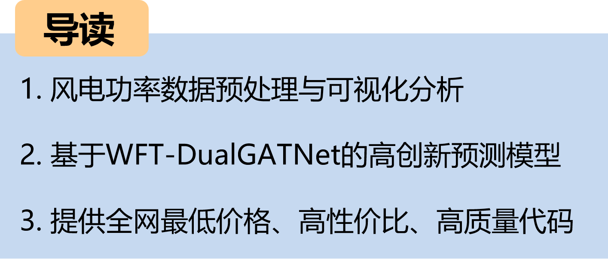
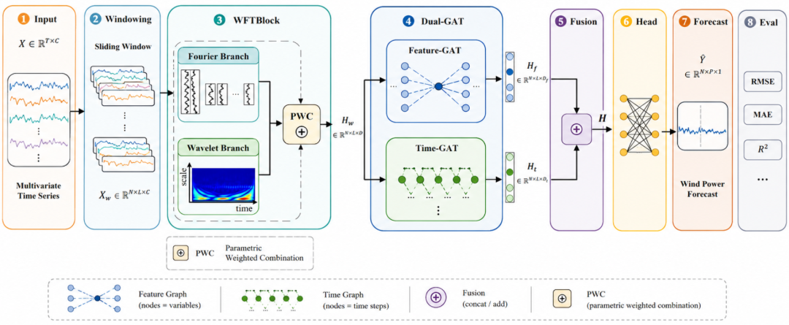

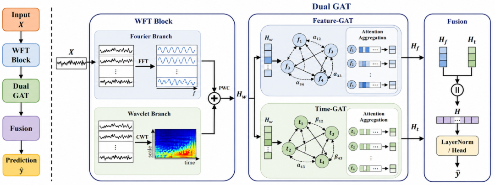
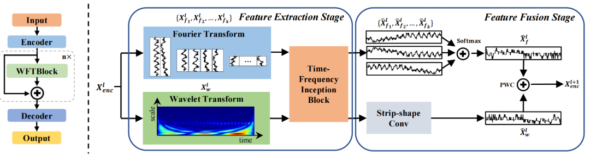
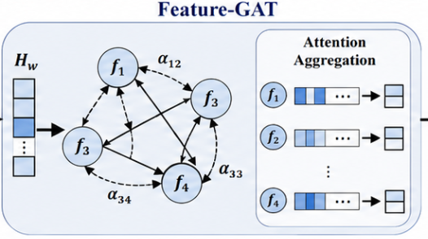
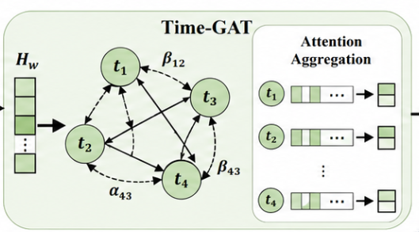
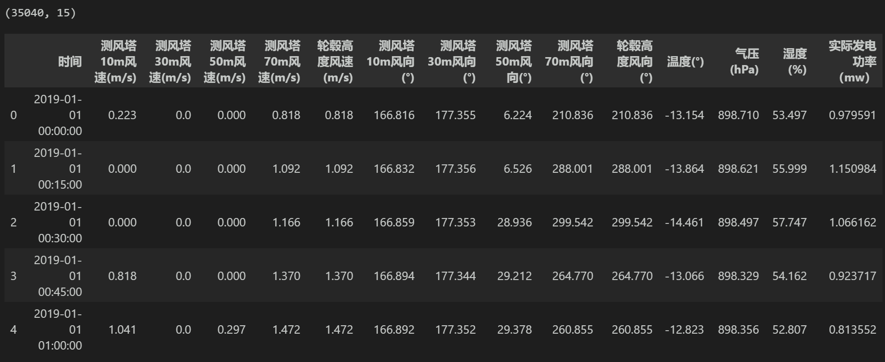
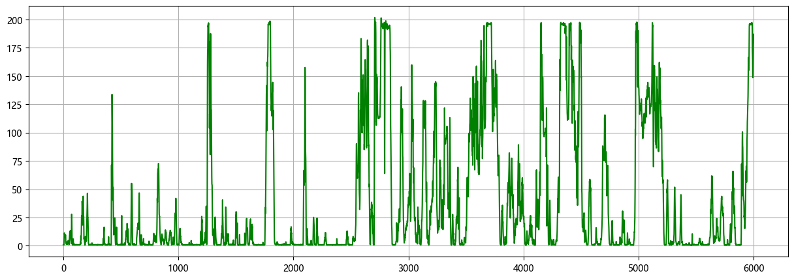

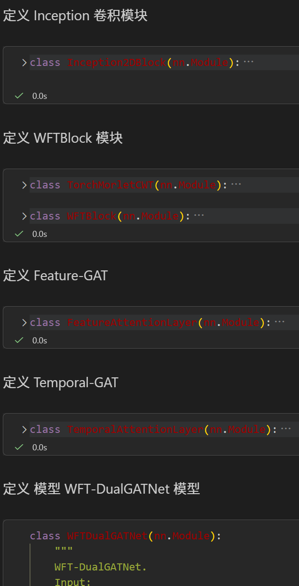
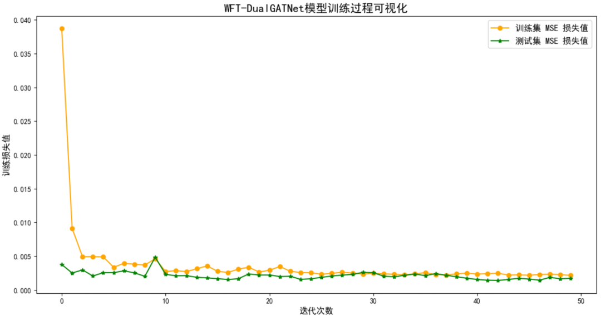
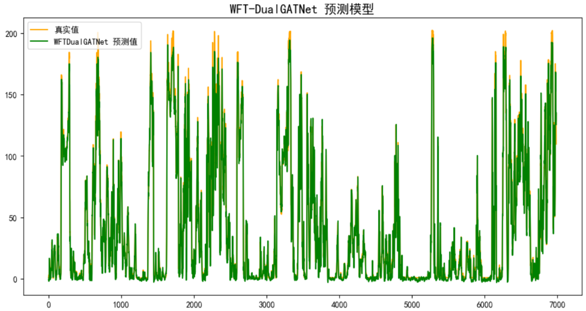
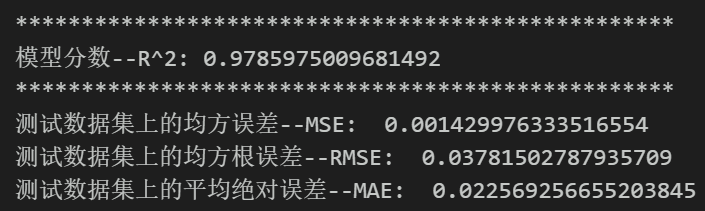
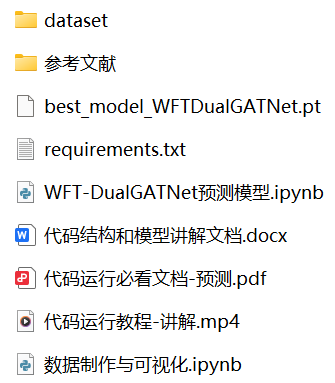

<!-- PAYMENT_BLOCK -->

## Get this dataset

- Payment link (Stripe): [Buy now](https://buy.stripe.com/3cs8yP7sY87d0vu9AB)
- Payment QR code: 

<!-- /PAYMENT_BLOCK -->
